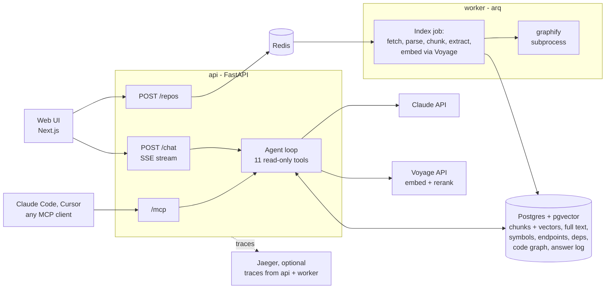

# Code Docs Assistant

Ask questions about a codebase: how it works, where something is implemented, which API endpoints and
dependencies it has. Every answer cites the exact files and lines it relies on.

Point it at a GitHub repository, a zip or a local folder. It indexes the code (syntax-aware chunks,
symbols, endpoints, dependencies, a code graph). A Claude agent then investigates each question with
tools and answers with `path:start-end` citations that open the cited code next to the answer.


**Contents:** [Screenshots](#screenshots) · [1. Quick setup](#1-quick-setup) ·
[2. Architecture](#2-architecture-overview) · [3. RAG and LLM approach](#3-rag-and-llm-approach) ·
[4. Key technical decisions](#4-key-technical-decisions) · [5. Production and scale](#5-productionizing-and-scaling) ·
[6. Engineering standards](#6-engineering-standards) · [7. AI tools](#7-how-i-used-ai-tools) ·
[8. With more time](#8-what-id-do-differently-with-more-time) · [Known limitations](#known-limitations)

**Reference docs:** [Evaluation](docs/evaluation.md) · [MCP server](docs/mcp.md) ·
[Observability](docs/observability.md) · [Development and configuration](docs/development.md)

## Screenshots

| | |
|---|---|
|  |  |
| **Investigating.** Each tool call appears live; the repo panel shows index stats, the code graph and phase timings. | **Usage.** Every answer is logged with its cost, latency and tool calls. |
|  |  |
| **Endpoints.** A complete table built at index time, not retrieved. | **Tracing.** One answer: Claude calls, tool calls and search stages. |

Demo video: _to be added._

## 1. Quick setup

You need Docker with Compose. Answers need an Anthropic API key. A Voyage key is optional.

```bash
git clone https://github.com/Nikhilprasad-r/code-doc.git
```

```bash
cd code-doc && cp .env.example .env
```

Edit `.env` and set `ANTHROPIC_API_KEY`. Add `VOYAGE_API_KEY` too if you want semantic search.

```bash
docker compose up --build
```

Open <http://localhost:3000>, paste `https://github.com/spring-projects/spring-petclinic`, and ask
"How does adding a new visit for a pet work?". PetClinic indexes in about 4 seconds.

- **Model:** `AGENT_MODEL` picks the Claude model. `.env.example` sets `claude-opus-5-5`; the
  screenshots were taken on `claude-haiku-5-5`.
- **Without `VOYAGE_API_KEY`:** an offline embedder is used. Keyword search, the structured tables
  and the graph still work; semantic search and reranking don't.
- **Tracing:** add Jaeger with
  `docker compose -f docker-compose.yml -f docker-compose.observability.yml up -d`, then open
  <http://localhost:16686>.
- **Tests:** run `docker compose up -d db`, then `cd backend && uv run pytest`.

| Service | Port | Role |
|---|---|---|
| web | 3000 | Next.js UI: chat, evidence panel, repo panel |
| api | 8000 | FastAPI: repos, search, streaming chat, `/stats`, MCP at `/mcp` (`/docs` for OpenAPI) |
| worker | – | arq worker that runs indexing jobs |
| db | 5433 | Postgres 17 + pgvector: every index and the answer log |
| redis | 6379 | job queue |
| jaeger (optional) | 16686 | trace viewer |

## 2. Architecture overview



**Indexing** runs in the worker:
1. **Fetch:** shallow-clone at a recorded commit, unzip, or read a folder.
2. **Walk:** keep only text worth indexing: no binaries, lockfiles, vendored folders or files over 1 MB.
3. **Parse** each file with tree-sitter, then:
   - split it into syntax-aware chunks,
   - extract its symbols, imports, HTTP endpoints and manifest dependencies.
4. **Write** everything to Postgres in one transaction.
5. **Embed** the chunks, with a cache keyed by content hash. Meanwhile, graphify builds the code graph
   as a separate process.

PetClinic (103 files) takes 3.5 s, of which 2.3 s is the git clone.

**Answering** runs in the api:
1. The agent gets the question, a short description of the repository, and 11 tools.
2. It calls tools until it has the evidence, running several at once when it asks for them together.
3. It streams an answer with citations.

The UI shows each tool call live (the investigation trail). It turns each paragraph or list item with
a citation into a stop on a rail, which opens the cited lines. A footer gives the model, time and cost.
The same tools are exposed over MCP, so a coding agent can use the index directly
([docs/mcp.md](docs/mcp.md)).

| Area | Code |
|---|---|
| Indexing | [backend/app/ingest/](backend/app/ingest/): source, chunker, symbols, endpoints, dependencies, code graph, pipeline |
| Retrieval | [backend/app/retrieval/](backend/app/retrieval/): code-aware tokenizer, embeddings, reranker, hybrid search |
| Agent | [backend/app/agent/](backend/app/agent/): tools, graph tools, prompt, loop, single-call RAG mode |
| Observability | [backend/app/observability/](backend/app/observability/): logs, answer log, stats, tracing |
| Evaluation | [backend/evals/](backend/evals/): 40 questions, graders, runner |
| UI | [frontend/components/](frontend/components/): chat, answer view, trail, evidence panel, repo panel |

## 3. RAG and LLM approach

The starting point: code questions are rarely answered by one retrieved chunk. "How does adding a visit
work?" means finding the endpoint, reading the handler, following it to the entity and the database
mapping. "List all endpoints" needs every endpoint, not the top 8 matches. So retrieval has three
channels, and an agent picks between them for each question:

- **Search:** hybrid keyword + vector search over syntax-aware chunks, for behaviour and concepts.
- **Structured facts:** tables built at index time (symbols, imports, endpoints, dependencies),
  for questions that need complete or exact answers.
- **Code graph:** modules, a symbol's links, and what depends on it, for structure and impact
  questions.

### Chunking

| Files | Method |
|---|---|
| Python, JavaScript, TypeScript/TSX, Java, Go | **Syntax-aware**, after [cAST](https://arxiv.org/abs/2506.15655): pack neighbouring syntax-tree nodes up to a budget of 1,500 non-whitespace characters, split a node that is too big into its children, merge leftovers smaller than a quarter of the budget into a neighbour. Chunks cover the file exactly, with no overlap. |
| Markdown | One chunk per heading section, merged or split to the same budget. `#` lines inside fenced code blocks are not headings. |
| Everything else | Line windows up to the same budget |

Each chunk carries a header that goes into both the embedding and the keyword index: `File:`, `Scope:`
(the enclosing class or function) and `Defines:` (the symbols it contains). A method chunk deep inside
a class still says which class and file it belongs to. For Markdown, `Scope:` is the heading path, such as
`section Setup > Docker`, so every piece of a long section keeps its heading. The header has no line numbers on purpose:
code that only moved keeps the same cache key and is not embedded again.

Fixed-size windows cut functions in half and lose the enclosing scope. One chunk per function falls
apart on very small and very large functions. The eval's baseline design uses 40-line windows with
10 lines of overlap, so the difference can be measured.

### Embedding model

| | Choice | Why |
|---|---|---|
| Final | **Voyage `voyage-code-3`**, 1,024 dimensions, with separate `document` and `query` input types; **Voyage `rerank-2.5`** to rerank | Trained for code retrieval; one vendor for embedding and reranking; vectors cached by content hash, so re-indexing PetClinic unchanged re-embedded nothing (366 of 366 from cache) |
| Weighed | General-purpose text embeddings | Not trained on code; identifiers and code structure retrieve worse |
| Weighed | Open models hosted ourselves | No per-token cost or data leaving the network, but GPU hosting to run |
| Fallback | An offline hashing embedder (`hash-v1`) | Lets the stack and tests run without any key. It does not capture meaning, so it is for development only. |

The screenshots and the measured answers above ran without a Voyage key, so they used the fallback.
Answers still worked through keyword search, the structured tables and the graph. Semantic search is
the one piece the demo doesn't show.

### Vector database and retrieval

**Final choice: Postgres 17 with pgvector.**
- Vectors are in the `chunks` table, with an HNSW index on cosine distance.
- The same database holds the full-text index, symbols, endpoints, dependencies, the code graph and
  the answer log.
- That means one service to run, one transaction per index write, and SQL joins across indexes.

**Weighed:**
- Dedicated vector stores (Qdrant, Pinecone, turbopuffer) scale further, but add a second datastore
  that the keyword index and the tables can't join with.
- Elasticsearch/OpenSearch does BM25 and vectors in one engine, but is heavier to run for one
  repository at a time.

**Hybrid search** (`search_code`):
- Keyword search (Postgres full text over code-aware terms: `getUserById` is indexed as
  `getuserbyid get user by id`) and vector search each return 50 candidates.
- Reciprocal Rank Fusion (k=60) merges the two lists.
- Voyage `rerank-2.5` reorders the top candidates.

Embeddings blur exact identifiers; keyword search finds them but misses paraphrases. The trace above
shows the cost: about 25 ms per search, not counting the network call to Voyage (the demo has no key).

**Structured tables:**
- `list_endpoints` covers FastAPI, Flask, Express, NestJS, Spring and Go routers. Router prefixes from
  another file are recorded as `MOUNT` rows, so the agent can compose full paths.
- `list_dependencies` reads seven manifest formats.
- `find_symbol` and `find_imports` complete the set.

They answer "list all..." questions completely, which top-k retrieval can't guarantee.

**Code graph:**
- [graphify](https://github.com/safishamsi/graphify) (MIT) extracts files, symbols and their links:
  calls, references, imports, inheritance.
- Three tools use it: `architecture` (modules and most connected symbols), `related` (one symbol's
  links) and `impact` (everything that depends on it).
- Graph results are matched to our symbol table, so they cite full line ranges.

### LLM

- **Claude, through the Anthropic SDK.** The model is a setting (`AGENT_MODEL`).
- **Claude Opus 5.5** is the default in `.env.example`, for answer quality on multi-step
  investigations.
- **The demo runs Claude Haiku 5.5**, 40 times cheaper per token. Measured answers so far:
  $0.0011–$0.0065 each, 4–19 s.
  - Its weakness showed up while taking the screenshots: it sometimes cited a bare file name
    (`Visit.java:35-41`) or merged two locations into one bracket. Three fixes followed: the prompt
    now asks for full paths and one location per bracket; the UI splits merged citations; and the file
    endpoint opens a shortened path when it matches exactly one file.
- **Claude Sonnet 5.5** sits in between, and is the eval's judge. The runner warns if asked to let a
  model judge its own answers.

**Request settings:**
- Adaptive thinking at `medium` effort.
- Streaming, with tool inputs streamed as they are generated and validated with pydantic before any
  tool runs.
- Prompt caching.
- Server-side fallback when a model declines, on the models that support it.

**Prices** are kept in one table ([backend/app/pricing.py](backend/app/pricing.py)), used for the
answer log and the eval.

Which model is good enough is what the eval is for: it can run the same 40 questions on Haiku and
Opus. That run hasn't happened yet ([docs/evaluation.md](docs/evaluation.md)).

### Orchestration framework

**None.** The agent loop is about 250 lines on the Anthropic SDK ([backend/app/agent/loop.py](backend/app/agent/loop.py)).
- The UI is built on the loop's events (tool started, tool finished with its sources, text, done
  with cost). They have to arrive in the right order and with the right detail.
- Prompt caching, validation of streamed tool inputs, refusals and model fallbacks all need direct
  control.
- The eval calls the same `answer_question` function the API does, so it measures the code that
  ships.

**Weighed:**
- LangChain/LangGraph and LlamaIndex would bring ready-made retrievers, but more layers between the
  code and the API, and less control over streaming and caching.
- The Claude Agent SDK or Managed Agents run a general agent with file and shell tools in a sandbox.
  That is powerful, but needs the repository in a sandbox and gives up the custom retrieval tools
  and UI events.

Background jobs use arq on Redis. The MCP server reuses the same tool functions.

### Prompt and context management

- **System prompt** ([backend/app/agent/prompts.py](backend/app/agent/prompts.py)):
  - The rule that every statement must come from tool output.
  - Which tool to use for each kind of question.
  - The citation format, `[path:start-end]`.
  - What to do when the code doesn't contain the answer.

  A short block describes the repository (name, commit, size, languages). The code-graph guidance is
  added only when the repository has a graph.
- **Context budget per tool result:**
  - Any result is clipped at 12,000 characters, with a note saying how to narrow the call.
  - `read_file` returns at most 300 lines.
  - `search_code` returns at most 15 chunks, each previewed at 60 lines.
- **Step limit:** after 12 tool rounds, tools are switched off and the model must answer from what it
  has, saying what it couldn't verify.
- **Prompt caching:** tool definitions, the system prompt and the growing conversation are cached.
  In the traced answer, each call re-read the previous context from cache: 0, then 3.4k, 9.3k and
  12.5k cached tokens.
- **Conversation memory:** each conversation's full history, including tool results, is stored and
  replayed for follow-up questions. Nothing trims or summarises it yet (see limitations).
- **Single-call RAG mode** (`mode=rag`, used by the eval baselines): 8 reranked excerpts in one prompt.

### Guardrails

**Grounding:**
- The prompt requires every statement to come from tool output, with a citation.
- The UI makes uncited claims visible: they get a hollow marker, and a line under each answer counts
  how many points cite code ("15 of 22 points cite code").
- Four eval questions ask about features that don't exist. Answering them correctly means saying
  they don't exist.

**Tool safety:**
- All 11 tools are read-only queries over the index; the agent can't run code or reach the network.
- Tool inputs are validated (unknown fields rejected), and regexes are length-limited and checked
  before use.

**Budgets:** a 12-step limit, an output-token cap, and per-answer cost tracking.

**Ingestion:**
- Only https git URLs, plus local folders when `ALLOW_LOCAL_PATHS` is on.
- Zip entries can't write outside their folder.
- Size limits, and binaries are skipped.
- graphify runs with no API keys in its environment and a timeout.
- `READ_ONLY=true` turns a public demo into a read-only one.

**MCP over HTTP:** only accepts localhost `Host` and `Origin` headers (DNS-rebinding protection).

**Missing:** authentication, rate limiting, and screening of repository content for prompt injection.
The read-only tools limit what an injected instruction could do, but nothing detects one. All three
are listed under production work.

### Quality

**Evaluation** ([docs/evaluation.md](docs/evaluation.md)):
- **Questions:** 40, reviewed by hand, about two pinned repositories. Each lists the facts a correct
  answer must state and where the evidence is (84 locations).
- **Designs compared:** naive vector RAG, hybrid RAG, the agent, and the agent with the code graph.
- **Metrics:**
  - correctness (Sonnet 5.5 as judge for prose, exact matching for lists),
  - citation validity,
  - whether a citation hits the evidence,
  - retrieval recall,
  - latency and cost.
- **Self-checks:** an oracle answer scores 1.00 and an empty answer scores 0. A judge check confirms
  the judge fails empty and off-topic answers.
- **Approval gate:** changing any eval file blocks new runs until a person re-approves, so results
  from different eval versions never mix.
- **Results: not run yet.** The table below will be filled in from `evals.run summarize`.

| Design | Correct | Valid cites | Cites gold | Found gold | $/question | Latency |
|---|---|---|---|---|---|---|
| naive-rag | – | – | – | – | – | – |
| hybrid-rag | – | – | – | – | – | – |
| agent | – | – | – | – | – | – |
| agent-graph | – | – | – | – | – | – |

**Tests:** 71 backend tests: 70 pass, and one is skipped when an API key is set, because it checks
the missing-key error.
- **Unit tests:** tokenizer, chunker, extractors, graders, graph conversion, log format.
- **Integration tests** against a real Postgres and a fixture repository covering six web frameworks in four languages:
  indexing, search modes, every tool, the agent loop with a scripted model, the MCP server, the answer
  log and stats endpoints, and span nesting.
- **Frontend:** strict TypeScript and ESLint, with no UI tests.

### Observability

Details in [docs/observability.md](docs/observability.md).
- **Answer log:** a row per answer from the web or MCP, with status, latency, time to first words,
  tokens, cost and each tool call. It is served by `/stats` and `/answers`, and shown in the Usage tab.
- **Structured logs:** JSON lines carrying a request ID and the trace ID.
- **Tracing:** OpenTelemetry spans for each answer (Claude calls with token counts, tool calls, search
  stages) and each indexing phase, viewed in Jaeger.

## 4. Key technical decisions

| Decision | Why | Trade-off |
|---|---|---|
| Agent with tools instead of one retrieve-then-answer call | Code questions are multi-hop: find the endpoint, read the handler, follow the call. Tool-using agents beat single-shot RAG on repository QA ([SWE-QA](https://arxiv.org/abs/2509.14635)). | More latency and tokens per answer, bounded by the step limit. The eval measures whether it pays off. |
| Structured tables for endpoints and dependencies | "List all endpoints" needs a complete answer, which top-k retrieval can't guarantee. | Pattern-based extraction misses unusual routing styles; `grep` is the fallback. |
| Keyword + vector search, reranked | Embeddings blur exact identifiers; keyword search finds them but misses paraphrases. | Two queries per search plus a rerank call. |
| One Postgres for every index | One service, transactional writes, joins across indexes. HNSW is fine into the millions of chunks. | Beyond that, vectors move to a dedicated store. |
| Index pinned to a commit | Citations always point at the exact code that was read. The eval's repositories are pinned the same way. | Re-indexing is needed to follow a branch. |
| Embedding cache keyed by content hash, chunk headers without line numbers | Re-indexing re-embeds only changed code. | A cache table to keep. |
| Code graph from graphify, as a separate process, pinned to an exact release | Multi-language extraction and module detection in 1–2 s per demo repo, no LLM calls. The separate process contains crashes and keeps API keys out. | A third-party format to track; covered by tests on its output. |
| No orchestration framework | Full control of streaming events, caching, fallback, and eval parity (see above). | More code owned: the loop, validation and retries. |
| Same tools over MCP | Coding agents (Claude Code, Cursor) can use the index, and the tools get a second set of callers. | One more endpoint to secure. |
| Observability built in (answer log, JSON logs, OpenTelemetry) | Cost and latency per answer are product questions, not just ops ones. | More code in the request path; tracing is off unless configured. |
| Haiku for the demo, model configurable | Haiku is 40× cheaper per token than Opus, which keeps exploring and recording the demo cheap. | Weaker multi-step reasoning and citation discipline; the eval quantifies this. |
| Offline embedding fallback | The stack and tests run without keys. | Not semantic; development only. |

## 5. Productionizing and scaling

### What changes before production

- **Accounts and tenancy:** sign-in (OIDC), repositories owned by an organisation, and row-level
  security in Postgres. Today the API and MCP endpoint have no authentication.
- **Shared file storage:** the api and worker share a Docker volume (`DATA_DIR`) for uploads, clones
  and graph output. In production that moves to object storage.
- **Durable jobs:** arq on Redis loses queued jobs if Redis restarts. A managed queue (SQS, Cloud
  Tasks, Service Bus) with retries and a dead-letter queue fixes that.
- **Schema migrations:** today the schema is created with `CREATE ... IF NOT EXISTS` on startup.
  Production needs a migration tool (Alembic).
- **Limits:** rate limits per user, a daily spend cap per organisation (the answer log already
  records cost), and request size limits.
- **Index consistency:** re-indexing replaces rows in place, so a search during a re-index can see a
  partial index. Writing each commit to its own snapshot and switching atomically fixes that.
- **Freshness:** index only the files changed between commits, triggered by a GitHub push webhook.
  The embedding cache already makes this cheap.
- **Security:**
  - Scan repositories for secrets before indexing, and keep `.env`-style files out of the index.
  - Screen tool output for prompt injection.
  - Keep keys in a secrets manager.
- **Long conversations:** summarise or trim old turns before the context grows too large.
- **Delivery:** CI (tests, lint, type checks, image build and scan), infrastructure as code, and
  staged deploys.

### Reference deployment on AWS

| Piece | AWS service | Notes |
|---|---|---|
| api + MCP | ECS Fargate behind an Application Load Balancer | Stateless; scale on CPU and open connections. Raise the ALB idle timeout so streamed answers aren't cut. |
| worker | ECS Fargate service | Scale on queue depth. Parsing and graphify are CPU-bound. |
| web | Next.js standalone on ECS or App Runner, behind CloudFront | |
| Database | Aurora PostgreSQL with pgvector, Multi-AZ | Read replicas for search; partition large tables by repository. |
| Queue | SQS (or ElastiCache Redis to keep arq) | |
| Files | S3 | Uploads, clone cache, graph output |
| LLM | Claude on Amazon Bedrock | IAM auth, billing and data in the AWS account. The Anthropic API also works. |
| Embeddings | Voyage API | Or an embedding model hosted in the account, if data must not leave it; re-run the eval to compare. |
| Secrets | Secrets Manager | |
| Logs and traces | CloudWatch Logs; AWS Distro for OpenTelemetry to X-Ray | The app already emits JSON logs and OTLP traces. |
| Edge and network | WAF, private subnets, VPC endpoints, KMS | |
| Delivery | GitHub Actions to ECR, then ECS; Terraform or CDK | |

### Other clouds

| Piece | GCP | Azure | Cloudflare |
|---|---|---|---|
| api, worker | Cloud Run (services; jobs for indexing) | Container Apps | Containers (the Python worker and graphify can't run in Workers) |
| Postgres + pgvector | Cloud SQL or AlloyDB | Azure Database for PostgreSQL | An external managed Postgres (Neon, Supabase) through Hyperdrive |
| Queue | Cloud Tasks or Pub/Sub | Service Bus | Queues |
| Files | Cloud Storage | Blob Storage | R2 |
| Claude | Vertex AI | Microsoft Foundry | Anthropic API, through AI Gateway for caching and limits |
| Traces | Cloud Trace | Application Insights | Any OTLP backend |

On Cloudflare, Vectorize would replace pgvector, but it would split hybrid search across two systems.
Keeping Postgres is simpler.

### Scaling past one large repository

- **More repositories:** add workers. Indexing is per repository, and the api is stateless.
- **Larger repositories (monorepos):**
  - `grep` scans stored files in Python; use a trigram index (zoekt) or ripgrep over the checkout.
  - Move vectors to a dedicated store once a single index reaches tens of millions of chunks.
  - Move keyword search to a BM25 engine (ParadeDB `pg_search`, Tantivy).
- **Precision:** SCIP indexes (compiler-grade definitions and references) would make `related` and
  `impact` exact, including calls into dependencies.
- **Operations:**
  - Metrics and dashboards (OpenTelemetry metrics into Prometheus/Grafana).
  - Error tracking (Sentry).
  - Alerts on error rate, latency and daily spend.
  - Retention for the answer log, and a persistent trace store.

## 6. Engineering standards

**Followed:**
- **Clear module boundaries:** ingest, retrieval, agent, observability, evals. Docstrings explain the
  why, not the what.
- **Validated inputs:** typed Python with pydantic validation at the edges (API bodies, tool inputs,
  settings).
- **Tests close to real use:** integration tests run against a real Postgres. A scripted model stands
  in for Claude, so the agent loop, MCP server and answer log are tested without API calls.
- **An eval with safeguards:** self-checks and an approval gate, so quality claims can be measured
  and reproduced.
- **Reproducible builds:**
  - Lockfiles for Python (`uv.lock`) and Node (`pnpm-lock.yaml`).
  - Exact pins for graphify and OpenTelemetry, to releases at least two weeks old.
  - Re-tested after the graphify version changed.
- **One-command Docker setup;** configuration through environment variables only; no secrets in the
  repository.
- **Observable by default:** structured logs, a record of every answer, opt-in tracing.
- **Security basics:** safe zip extraction, read-only tools, a minimal environment for subprocesses,
  DNS-rebinding protection on MCP, and no prompt or answer text in traces.
- **Frontend:** strict TypeScript and ESLint.

**Skipped, for time:**
- CI pipeline.
- Python linter, formatter and type checker in the toolchain.
- Frontend tests.
- Database migrations.
- Authentication.
- Load tests.
- Docker images pinned by digest.
- An accessibility audit of the UI.

## 7. How I used AI tools

_To be written in my own words._

<!--
Notes from this project to draw on (delete before submitting):
- Tool: Claude Code in the desktop app, as a pair programmer across research, building, testing in the
  app's browser pane, and writing docs.
- Started with research and clarifying questions; I made the scope calls: Claude API, FastAPI + Next.js,
  500k-line repos, 2–3 days, demo on PetClinic and the FastAPI template.
- Kept decisions with me: reviewed and approved all 40 eval questions; only I can run `evals.run approve`
  (the harness gate exists so the AI can't change the eval and re-approve it); asked before any paid run;
  chose Haiku for the demo after seeing the trade-offs; picked the UI direction (evidence rail + trail)
  from several options; chose Jaeger and the Usage tab when planning observability.
- Used plan mode before the observability work and approved the plan before any code was written.
- Rules I set: no AI attribution in commits or files; I commit myself.
- Verification habits: tests after every change; checking claims against the real system. Example: the
  AI first claimed graphify missed calls through objects. That came from testing version 0.9.8; the
  version actually installed resolved them, so the claim was corrected and the dependency pinned to a
  reviewed release.
- The AI found its own mistakes in testing: a wrong gold-location count in the README (95 vs 84), an
  httpx instrumentation that did nothing, and Haiku's shortened citations found while taking screenshots.
- Do's and don'ts, and how you make AI output match your preferences and stay repeatable (CLAUDE.md,
  memory, skills, plan mode, tests as the contract) are yours to write.
-->

## 8. What I'd do differently with more time

_To be written in my own words._

<!--
Candidates from this project (pick, reorder, and say why in your words):
- Run the eval first and let the numbers drive the next changes: Haiku vs Opus, agent vs RAG, with vs
  without the graph.
- Incremental indexing from push webhooks, with per-commit snapshots.
- Auth, tenancy, rate limits and spend caps; deploy a public read-only demo.
- CI with lint and type checks, plus frontend tests.
- Trim or summarise long conversations.
- Real embeddings in the demo (a Voyage key) and a recorded video.
-->

## Known limitations

- **Citation slips on smaller models.** Haiku sometimes cites a bare file name or merges locations.
  The UI copes with both: it opens a shortened path when it matches exactly one file, and splits
  merged citations. An ambiguous name like `schema.sql` lists its candidates instead. The eval's
  `cite_valid` metric deliberately stays strict and still counts shortened paths as invalid, so it
  keeps measuring citation discipline.
- **The demo runs without semantic embeddings.** There was no Voyage key, so search was keyword-only.
- **Endpoint extraction is pattern-based.** Prefixes set in another file or from configuration (such
  as `prefix=settings.API_V1_STR`) appear as `MOUNT` rows instead of being resolved.
- **Syntax-aware chunking covers five languages** (Python, JavaScript, TypeScript, Java, Go). Other
  languages are split by lines; the code graph covers more of them.
- **The code graph finds calls by static analysis.** Calls through untyped variables, callbacks or
  framework wiring can be missing; the tools say so and point to `grep`.
- **Conversations are never trimmed,** so very long ones grow until they hit the context limit.
- **Re-indexing replaces rows in place;** a search during a re-index can see a partial index.
- **No authentication or rate limiting.** Deploy only behind your own auth, with `READ_ONLY=true` for
  a public demo.
- **The eval hasn't been run yet,** so model and design comparisons are still claims, not numbers.
- **Version pins:** `tree-sitter` is pinned below 0.26 (0.26.0 segfaults on linux/aarch64), and
  graphify to exactly 0.9.95.
- **Port:** the database is published on port 5433, to avoid clashing with a local Postgres.

Third-party: [graphify](https://github.com/safishamsi/graphify) (MIT), tree-sitter, Voyage AI,
Anthropic, Jaeger.
