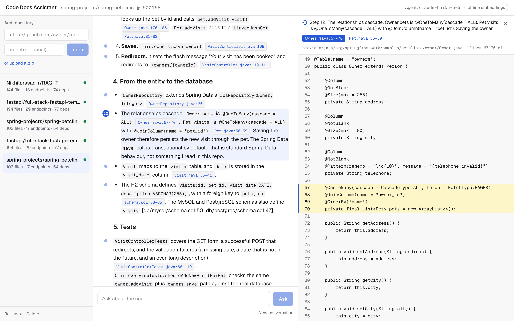
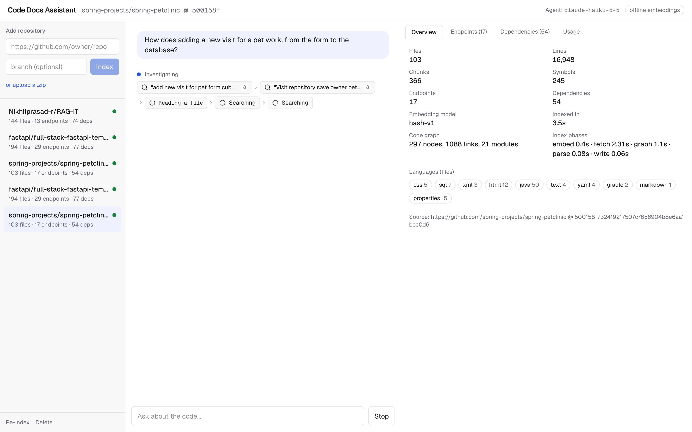
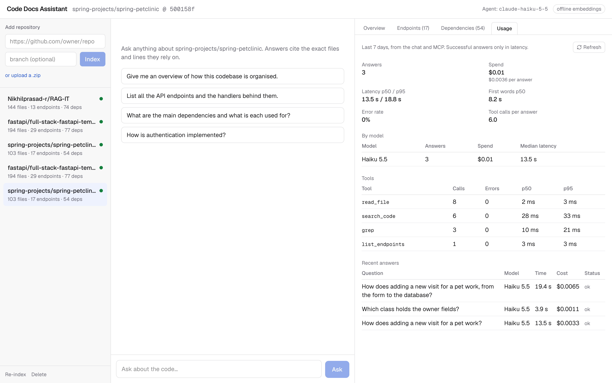
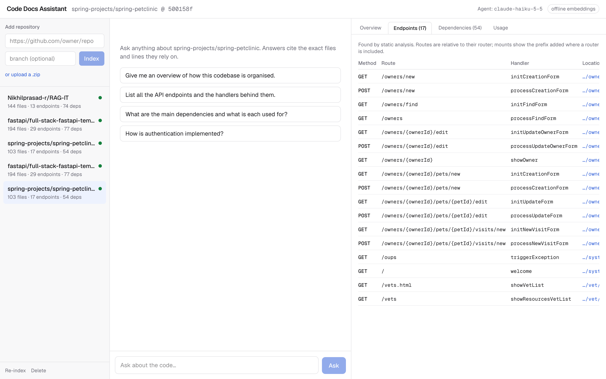
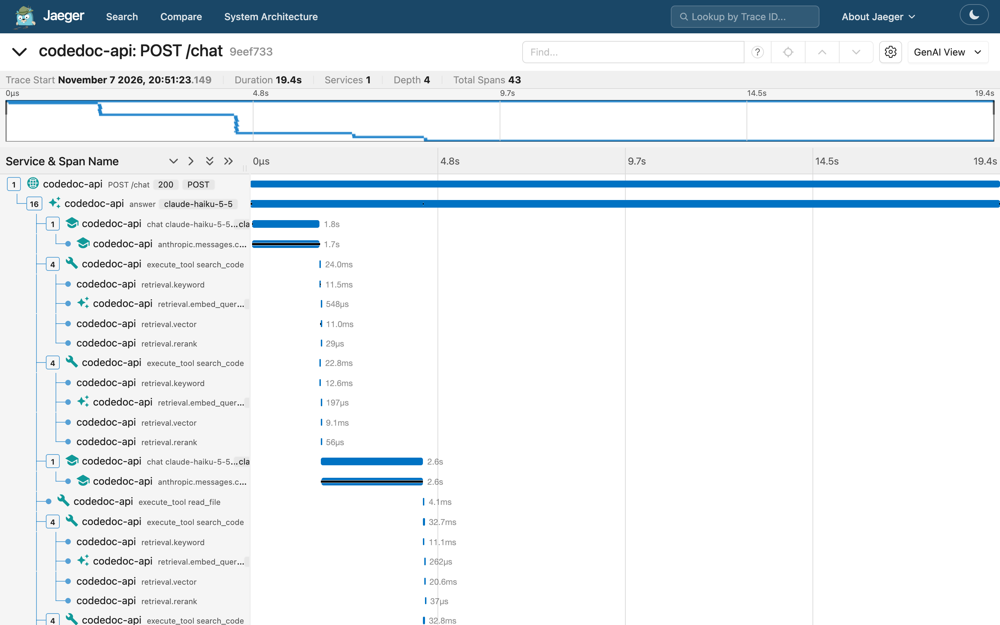
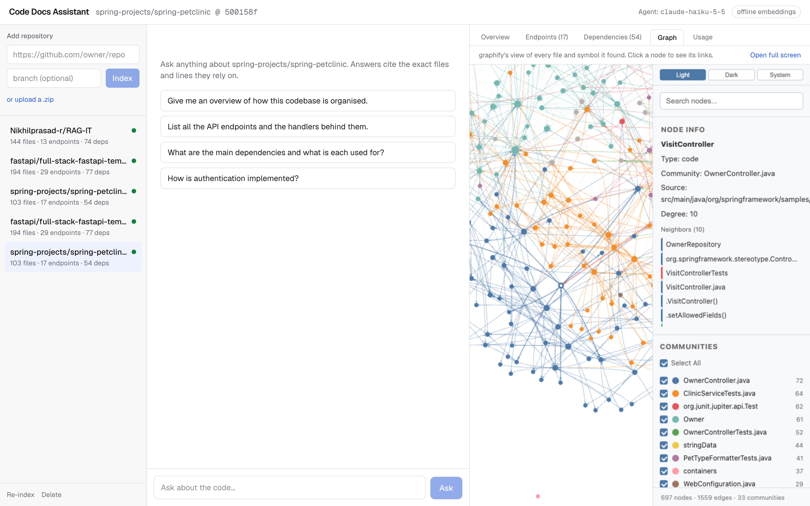

# Code Docs Assistant

Ask questions about a codebase: how it works, where something is implemented, which API endpoints and
dependencies it has. Every answer cites the exact files and lines it relies on.

Point it at a GitHub repository, a zip or a local folder. It indexes the code (syntax-aware chunks,
symbols, endpoints, dependencies, a code graph). A Claude agent then investigates each question with
tools and answers with `path:start-end` citations that open the cited code next to the answer.



## Documentation

The write-up follows the assignment's list, one page per part:

| | Page | Covers |
|---|---|---|
| 1 | [Quick setup](#quick-setup) | Below on this page: run it with Docker |
| 2 | [Architecture](docs/architecture.md) | Services, how indexing and answering work, where the code is |
| 3 | [RAG and LLM approach](docs/rag-and-llm.md) | Chunking, embedding model, vector database and retrieval, LLM, orchestration, prompt and context management, guardrails, quality, observability: what was weighed and what was chosen |
| 4 | [Key technical decisions](docs/decisions.md) | Each decision, why, and its trade-off |
| 5 | [Productionizing and scaling](docs/production.md) | What changes before production; deploying on AWS, GCP, Azure or Cloudflare; scaling |
| 6 | [Engineering standards](docs/engineering-standards.md) | Followed, and skipped for time |
| 7 | [How I used AI tools](docs/ai-tools.md) | How I worked with AI coding tools, and my do's and don'ts |
| 8 | [What I'd do differently](docs/with-more-time.md) | What I'd change or add next |
| | [Known limitations](docs/limitations.md) | Edge cases and gaps |

**Reference:** [Evaluation](docs/evaluation.md) · [MCP server](docs/mcp.md) ·
[Observability](docs/observability.md) · [Development and configuration](docs/development.md)

## Screenshots

| | |
|---|---|
|  |  |
| **Investigating.** Each tool call appears live; the repo panel shows index stats, the code graph and phase timings. | **Usage.** Every answer is logged with its cost, latency and tool calls. |
|  |  |
| **Endpoints.** A complete table built at index time, not retrieved. | **Tracing.** One answer: Claude calls, tool calls and search stages. |
|  | |
| **Code graph.** graphify's interactive view in the Graph tab. Selecting a node lists its links. | |

Demo video: _to be added._

## Quick setup

You need Docker with Compose. Answers need an Anthropic API key. A Voyage key is optional.

```bash
git clone https://github.com/Nikhilprasad-r/code-doc.git
```

```bash
cd code-doc && cp .env.example .env
```

Edit `.env` and set `ANTHROPIC_API_KEY`. Add `VOYAGE_API_KEY` too if you want semantic search.

```bash
docker compose up --build
```

Open <http://localhost:3000>, paste `https://github.com/spring-projects/spring-petclinic`, and ask
"How does adding a new visit for a pet work?". PetClinic indexes in about 4 seconds.

- **Model:** `AGENT_MODEL` picks the Claude model. `.env.example` sets `claude-haiku-5-5`, which
  the screenshots use; left unset, it defaults to `claude-opus-5-5`.
- **Without `VOYAGE_API_KEY`:** an offline embedder is used. Keyword search, the structured tables
  and the graph still work; semantic search and reranking don't.
- **Tracing:** add Jaeger with
  `docker compose -f docker-compose.yml -f docker-compose.observability.yml up -d`, then open
  <http://localhost:16686>.
- **Tests:** run `docker compose up -d db`, then `cd backend && uv run pytest`.

| Service | Port | Role |
|---|---|---|
| web | 3000 | Next.js UI: chat, evidence panel, repo panel |
| api | 8000 | FastAPI: repos, search, streaming chat, `/stats`, MCP at `/mcp` (`/docs` for OpenAPI) |
| worker | – | arq worker that runs indexing jobs |
| db | 5433 | Postgres 17 + pgvector: every index and the answer log |
| redis | 6379 | job queue |
| jaeger (optional) | 16686 | trace viewer |

Next: [Architecture](docs/architecture.md)

Third-party: [graphify](https://github.com/safishamsi/graphify) (MIT), tree-sitter, Voyage AI,
Anthropic, Jaeger.
