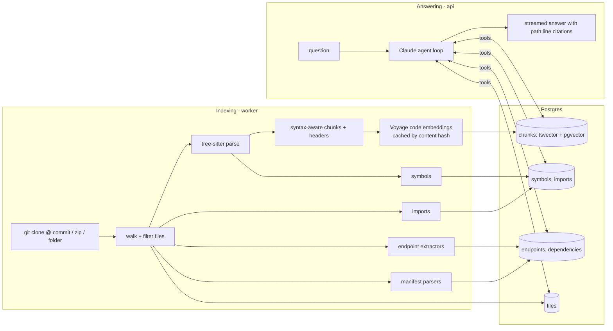

# Code Docs Assistant

Ask questions about a codebase — how it works, where something is implemented, which API endpoints
and dependencies it has — and get answers that cite the exact files and lines they rely on.

It ingests a GitHub repository, an uploaded zip, or a local folder, builds several indexes over it,
and answers with a Claude agent that searches and reads the code through tools.

## Quick start

```bash
cp .env.example .env        # add ANTHROPIC_API_KEY and VOYAGE_API_KEY
docker compose up --build
```

Open <http://localhost:3000>, paste `https://github.com/spring-projects/spring-petclinic`, and ask
"List all the API endpoints and the handlers behind them."

Both keys are optional for a first look. Without `VOYAGE_API_KEY`, indexing uses an offline hashing
embedder (keyword search still works well, semantic search does not). Without `ANTHROPIC_API_KEY`,
everything except chat works.

| Service | URL / port | Role |
|---|---|---|
| web | <http://localhost:3000> | Next.js chat UI with code viewer |
| api | <http://localhost:8000> | FastAPI: repos, search, streaming chat (`/docs` for OpenAPI) |
| worker | – | arq worker that runs indexing jobs |
| db | localhost:5433 | Postgres 17 + pgvector (all indexes) |
| redis | localhost:6379 | job queue |

## How it works



### Indexing

1. **Source.** Git URLs are shallow-cloned and the commit SHA is recorded, so every citation refers
   to a fixed snapshot. Zips are extracted with path-traversal checks.
2. **Syntax-aware chunking** (Python, JavaScript, TypeScript/TSX, Java, Go). Files are split along
   tree-sitter node boundaries with a recursive split-then-merge pass (after
   [cAST](https://arxiv.org/abs/2506.15655)): nodes that fit the budget are packed together,
   oversized ones are split into their children. Chunks partition the file exactly. Each chunk gets
   a header — file path, enclosing scope (`class OwnerController`), and the symbols it defines — that
   goes into both the embedding and the keyword index. Other text files use heading- or line-based
   chunks.
3. **Structured facts**, extracted once instead of retrieved at question time:
   - *Symbols*: functions, classes, methods, interfaces, types with qualified names and line ranges.
   - *Imports*: module → file, to answer "where is X used".
   - *Endpoints*: FastAPI, Flask, Express, NestJS, Spring, Go (net/http, gin, echo, chi). Router
     prefixes declared in the same file are applied; cross-file mounts (`include_router`,
     `app.use('/api', router)`) are recorded as `MOUNT` rows so the agent can compose full paths.
   - *Dependencies*: `pyproject.toml`, `requirements*.txt`, `package.json`, `pom.xml`,
     `build.gradle(.kts)`, `go.mod`, `Cargo.toml`, with versions and scopes.
4. **Embeddings** with `voyage-code-3`, cached by a hash of the chunk text. Re-indexing a new commit
   only embeds chunks that changed (re-indexing PetClinic with no changes: 366/366 cache hits).

### Answering

The agent (Claude, `claude-opus-5-5` by default) works through eight tools:

| Tool | Backed by | Typical question |
|---|---|---|
| `repo_overview` | file tree, README, stats | "How is this codebase organised?" |
| `search_code` | hybrid search (below) | "How does checkout work?" |
| `read_file` | stored file contents | following a call chain |
| `grep` | regex over all files | exact identifiers, config keys, call sites |
| `find_symbol` | symbols table | "Where is `OwnerRepository` defined?" |
| `list_endpoints` | endpoints table | "What are the API endpoints?" |
| `list_dependencies` | dependencies table | "What does this depend on?" |
| `find_imports` | imports table | "What uses Redis?" |

**Hybrid search** runs Postgres full-text search over code-aware terms (`getUserById` is indexed as
`getuserbyid get user by id`) and pgvector similarity in parallel, fuses the lists with Reciprocal
Rank Fusion, then reranks the top candidates with Voyage `rerank-2.5`.

Answers stream to the browser over server-sent events. Every claim is cited as `[path:start-end]`;
the UI turns those into links that open the code viewer at the highlighted lines, and lists every
tool call with the sources it returned. The system prompt and tool definitions are prompt-cached, so
each step of the agent loop re-reads the growing conversation from cache. Server-side refusal
fallback is enabled for models that support it.

## Design decisions

| Decision | Why | Trade-off |
|---|---|---|
| Agent with tools instead of one retrieve-then-answer call | Code questions are multi-hop: find the endpoint, read the handler, follow the service call. Tool-using agents beat single-shot RAG on repository QA ([SWE-QA](https://arxiv.org/abs/2509.14635)). | More latency and tokens per answer; bounded by a 12-step limit. |
| Structured tables for endpoints and dependencies | "List all endpoints" needs a complete answer; top-k retrieval can't guarantee that. | Pattern-based extraction misses unusual routing styles; `grep` is the fallback. |
| Keyword + vector search, not vectors alone | Embeddings blur exact identifiers; keyword search nails them but misses paraphrases. | Two queries per search plus a rerank call. |
| One Postgres for every index | One service to run, transactional writes, SQL joins across indexes. Fine to millions of chunks with HNSW. | Past that, move vectors to a dedicated store (see below). |
| Offline hashing embedder fallback | The stack runs and tests pass with no API keys. | Not semantic; only for development. |

## Scaling path

What is built for single repositories up to roughly 500k lines, and what changes beyond that:

- **Throughput.** Indexing runs in arq workers, so adding workers scales across repositories.
  Within one repository, parsing could move to a process pool and embedding batches could run
  concurrently.
- **Freshness.** The embedding cache already makes re-indexing cheap. Next: index only files changed
  between two commits (`git diff --name-only`), triggered by a GitHub push webhook.
- **Consistency during re-index.** Rows are replaced in place today, so a search during re-indexing
  can see a partial index. Writing each commit to its own snapshot and switching atomically fixes this.
- **Large repositories.** `grep` scans stored files in Python; for monorepos, use a trigram index
  (zoekt) or ripgrep over the checkout. Move vectors to Qdrant or turbopuffer, and keyword search to
  a BM25 engine (ParadeDB `pg_search`, Tantivy).
- **Precision.** Replace name-based symbol lookup with SCIP indexes for exact definitions and
  references, and add a call graph for "what calls X" and "what does this request touch".
- **Many repositories / tenants.** Per-organisation isolation, auth, and cross-repo search
  (linking an HTTP client call to the endpoint in another service).

## Development

Run the stack's dependencies in Docker and the apps locally:

```bash
docker compose up -d db redis
```

```bash
cd backend && uv run uvicorn app.main:app --reload
```

```bash
cd backend && uv run arq app.worker.WorkerSettings
```

```bash
cd frontend && pnpm install && pnpm dev
```

Without Redis the API indexes in-process, so the worker is optional locally.

Tests (unit tests always; integration tests when Postgres is up):

```bash
cd backend && uv run pytest
```

### Layout

```
backend/app/
  ingest/      source handling, chunker, symbols, endpoints, dependencies, pipeline
  retrieval/   tokenizer, embeddings + reranker, hybrid search
  agent/       tools, system prompt, streaming agent loop
  main.py      HTTP API      worker.py   arq worker
backend/tests/ unit + integration tests, multi-framework fixture repo
frontend/      Next.js UI (repo list, chat, code viewer, endpoints/dependencies tabs)
```

### Configuration

Set in `.env` (see `.env.example`):

| Variable | Default | Notes |
|---|---|---|
| `ANTHROPIC_API_KEY` | – | Required for chat |
| `AGENT_MODEL` | `claude-opus-5-5` | `claude-sonnet-5-5` is cheaper and faster |
| `AGENT_EFFORT` | `medium` | `low` … `max` |
| `VOYAGE_API_KEY` | – | Enables semantic embeddings and reranking |
| `EMBED_MODEL` / `EMBED_DIM` | `voyage-code-3` / `1024` | Changing the dimension needs a fresh database |
| `RERANK_MODEL` | `rerank-2.5` | |
| `ALLOW_LOCAL_PATHS` | `true` | Set `false` on any shared deployment |
| `READ_ONLY` | `false` | Public demo mode: no adding, re-indexing or deleting repositories |

## Known limitations

- Endpoint extraction is pattern-based. Prefixes set in another file or from configuration (e.g.
  `prefix=settings.API_V1_STR`) are shown as `MOUNT` rows rather than resolved.
- Syntax-aware chunking covers Python, JavaScript, TypeScript, Java and Go; other languages are
  chunked by lines.
- `tree-sitter` is pinned below 0.26: 0.26.0 segfaults on linux/aarch64 when traversing trees after
  many parses.
- The database is published on host port 5433 to avoid clashing with a locally installed Postgres.
