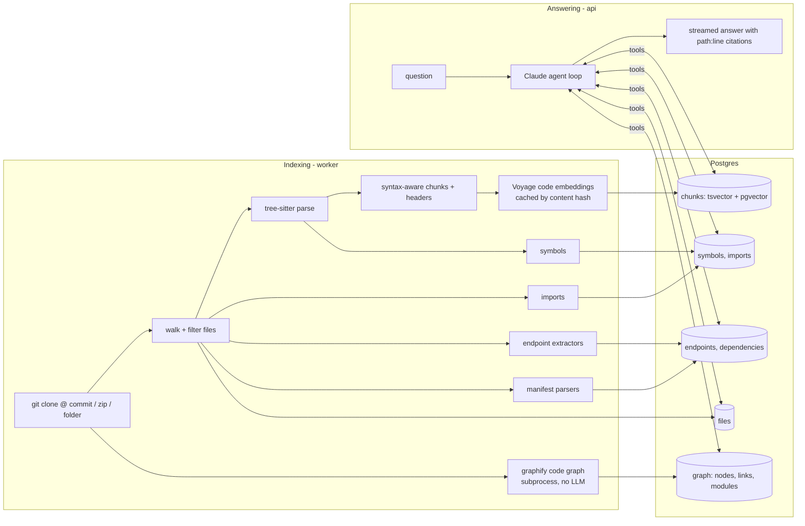

# Code Docs Assistant

Ask questions about a codebase — how it works, where something is implemented, which API endpoints
and dependencies it has — and get answers that cite the exact files and lines they rely on.

It ingests a GitHub repository, an uploaded zip, or a local folder, builds several indexes and a code
graph over it, and answers with a Claude agent that searches and reads the code through tools.

## Quick start

```bash
cp .env.example .env        # add ANTHROPIC_API_KEY and VOYAGE_API_KEY
docker compose up --build
```

Open <http://localhost:3000>, paste `https://github.com/spring-projects/spring-petclinic`, and ask
"List all the API endpoints and the handlers behind them."

Both keys are optional for a first look. Without `VOYAGE_API_KEY`, indexing uses an offline hashing
embedder (keyword search still works well, semantic search does not). Without `ANTHROPIC_API_KEY`,
everything except chat works.

| Service | URL / port | Role |
|---|---|---|
| web | <http://localhost:3000> | Next.js chat UI with code viewer |
| api | <http://localhost:8000> | FastAPI: repos, search, streaming chat (`/docs` for OpenAPI) |
| worker | – | arq worker that runs indexing jobs |
| db | localhost:5433 | Postgres 17 + pgvector (all indexes) |
| redis | localhost:6379 | job queue |
| jaeger (optional) | <http://localhost:16686> | trace viewer, with `docker-compose.observability.yml` (see [Observability](#observability)) |

## How it works



### Indexing

1. **Source.** Git URLs are shallow-cloned and the commit SHA is recorded, so every citation refers
   to a fixed snapshot. Zips are extracted with path-traversal checks.
2. **Syntax-aware chunking** (Python, JavaScript, TypeScript/TSX, Java, Go). Files are split along
   tree-sitter node boundaries with a recursive split-then-merge pass (after
   [cAST](https://arxiv.org/abs/2506.15655)): nodes that fit the budget are packed together,
   oversized ones are split into their children. Chunks partition the file exactly. Each chunk gets
   a header — file path, enclosing scope (`class OwnerController`), and the symbols it defines — that
   goes into both the embedding and the keyword index. Other text files use heading- or line-based
   chunks.
3. **Structured facts**, extracted once instead of retrieved at question time:
   - *Symbols*: functions, classes, methods, interfaces, types with qualified names and line ranges.
   - *Imports*: module → file, to answer "where is X used".
   - *Endpoints*: FastAPI, Flask, Express, NestJS, Spring, Go (net/http, gin, echo, chi). Router
     prefixes declared in the same file are applied; cross-file mounts (`include_router`,
     `app.use('/api', router)`) are recorded as `MOUNT` rows so the agent can compose full paths.
   - *Dependencies*: `pyproject.toml`, `requirements*.txt`, `package.json`, `pom.xml`,
     `build.gradle(.kts)`, `go.mod`, `Cargo.toml`, with versions and scopes.
4. **Embeddings** with `voyage-code-3`, cached by a hash of the chunk text. Re-indexing a new commit
   only embeds chunks that changed (re-indexing PetClinic with no changes: 366/366 cache hits).
5. **Code graph**, built by [graphify](https://github.com/safishamsi/graphify) (MIT) while the
   embeddings are computed. graphify parses the checkout with tree-sitter (no LLM calls, 20+
   languages). Its nodes are files and symbols. Its links cover calls, references, imports,
   inheritance and membership, and it groups the nodes into communities, which this app calls
   modules. Only its output file (`graph.json`) is relied on:
   - Nodes are kept only for indexed code files, and matched to the symbol table so each one has a
     full line range to cite.
   - Names defined outside the repository (library types, annotations) become one external node each.
   - Each module is labelled by its most connected symbols and its main directory.

   graphify runs as a subprocess with no API keys in its environment. Its output goes under
   `DATA_DIR`, never into the repository. If it fails, the rest of the index is unaffected and the
   graph tools are simply not offered. PetClinic: 297 nodes, 1,088 links, 21 modules in 1.2 s. FastAPI
   template: 907 nodes, 2,990 links, 60 modules in 1.9 s.

### Answering

The agent (Claude, `claude-opus-5-5` by default) works through eleven tools:

| Tool | Backed by | Typical question |
|---|---|---|
| `repo_overview` | file tree, README, stats | "How is this codebase organised?" |
| `search_code` | hybrid search (below) | "How does checkout work?" |
| `read_file` | stored file contents | following a call chain |
| `grep` | regex over all files | exact identifiers, config keys, call sites |
| `find_symbol` | symbols table | "Where is `OwnerRepository` defined?" |
| `list_endpoints` | endpoints table | "What are the API endpoints?" |
| `list_dependencies` | dependencies table | "What does this depend on?" |
| `find_imports` | imports table | "What uses Redis?" |
| `architecture` | code graph: modules, most connected symbols | "How is this codebase organised?" |
| `related` | code graph: one symbol's links | "What does `login_access_token` call?" |
| `impact` | code graph: dependants, by distance | "What breaks if I change `Owner.addVisit`?" |

The three graph tools are offered only for repositories whose graph was built.

**Hybrid search** runs Postgres full-text search over code-aware terms (`getUserById` is indexed as
`getuserbyid get user by id`) and pgvector similarity in parallel, fuses the lists with Reciprocal
Rank Fusion, then reranks the top candidates with Voyage `rerank-2.5`.

Answers stream to the browser over server-sent events. Every claim is cited as `[path:start-end]`,
and the UI is built around those citations:

- **Investigation trail.** The agent's tool calls appear live as a trail of steps above the answer
  (searches, symbol lookups, files read, graph lookups), each showing how many code locations it
  returned.
- **Evidence rail.** Each paragraph, list item and table row of the answer is a claim. Claims that
  cite code get a stop on a rail beside the answer. Hovering, clicking, or scrolling a claim into
  view shows its cited lines in the evidence panel, with every citation of that claim highlighted.
  Claims without a citation get a hollow marker, and a line under the answer counts how many points
  cite code.
- **Cross-highlighting.** Hovering a claim lights up the trail steps that found its evidence;
  hovering a step outlines the claims it supports.
- **Answer footer.** Each answer ends with what it took: model, tool calls, total time and time to the
  first words, and cost (token counts on hover).

The system prompt and tool definitions are prompt-cached, so each step of the agent loop re-reads
the growing conversation from cache. Server-side refusal fallback is enabled for models that support it.

## Design decisions

| Decision | Why | Trade-off |
|---|---|---|
| Agent with tools instead of one retrieve-then-answer call | Code questions are multi-hop: find the endpoint, read the handler, follow the service call. Tool-using agents beat single-shot RAG on repository QA ([SWE-QA](https://arxiv.org/abs/2509.14635)). | More latency and tokens per answer; bounded by a 12-step limit. |
| Structured tables for endpoints and dependencies | "List all endpoints" needs a complete answer; top-k retrieval can't guarantee that. | Pattern-based extraction misses unusual routing styles; `grep` is the fallback. |
| Keyword + vector search, not vectors alone | Embeddings blur exact identifiers; keyword search nails them but misses paraphrases. | Two queries per search plus a rerank call. |
| One Postgres for every index | One service to run, transactional writes, SQL joins across indexes. Fine to millions of chunks with HNSW. | Past that, move vectors to a dedicated store (see below). |
| Offline hashing embedder fallback | The stack runs and tests pass with no API keys. | Not semantic; only for development. |
| Code graph from graphify, run as a subprocess | "What uses X" and "what does this module connect to" are graph questions. graphify already does multi-language extraction and community detection, in seconds and without LLM calls. A subprocess contains crashes and keeps API keys out of it. | A third-party format to track: pinned to an exact release and covered by tests. Calls are resolved statically, so some are missing; the tools say so and point to `grep`. |

## Evaluation

The eval measures whether the design choices above actually matter. It asks the same 40 questions of
four designs and grades every answer.

**Questions** ([backend/evals/CASES.md](backend/evals/CASES.md)): 20 each about
`spring-projects/spring-petclinic` and `fastapi/full-stack-fastapi-template`, pinned to fixed commits.
They cover overview (4), where-is (11), how-does-it-work (11), endpoints (5), dependencies (5), and 4
questions about features the code does not have, where the right answer is "it isn't there". Each
question lists the key facts a correct answer must state and the gold `path:start-end` locations of the
evidence, all checked against the pinned code.

**Designs**, all served by the same `answer_question` entry point the API uses:

| | Design | Index | Retrieval | Answering |
|---|---|---|---|---|
| (a) | `naive-rag` | fixed 40-line windows | vector only | one model call |
| (b) | `hybrid-rag` | syntax-aware chunks | keyword + vector, reranked | one model call |
| (c) | `agent` | syntax-aware chunks + structured tables | 8 tools, as many calls as it needs | agent loop |
| (d) | `agent-graph` (shipped) | (c) + code graph | (c)'s tools + `architecture`, `related`, `impact` | agent loop |

**Metrics** (0–1, higher is better):

| Metric | How it is graded |
|---|---|
| `correct` | Share of key facts stated correctly. List questions (all endpoints, drivers, libraries): each expected route or package must appear. Others: `claude-sonnet-5-5` marks each fact correct, missing, or incorrect. |
| `cite_valid` | Share of `[path:lines]` citations that point at real lines of the indexed commit. |
| `gold_cited` | Whether a citation overlaps a gold location. |
| `found_gold` | Whether anything retrieved or read overlaps a gold location (retrieval recall). |

The runner also records latency, tool calls, and tokens, and the summary prices them into $/question,
including the judge. Results go to `.claude/hillclimb/code-qa/` (`baseline` = a, `v1` = b, `v2` = c,
`v3` = d), and
an HTML report is built from them.

**Harness checks.** An oracle (the gold facts with gold citations) and a null (empty answer) are run
through the same runner and graders. The null scores 0 on every metric, except `cite_valid` on the 4
"isn't there" questions, where citing nothing is correct. The oracle scores 1.00 on every
programmatically graded metric, which also confirms that all 84 gold locations resolve in the index.
`evals.run judge-check` verifies that the judge gives 0 to an empty answer, "I don't know", and an
off-topic answer, and full marks to the oracle answer.

**Running it** (from `backend/`, with both API keys in `.env`):

```bash
uv run python -m evals.run prepare
```

```bash
uv run python -m evals.run judge-check
```

```bash
uv run python -m evals.run approve
```

```bash
uv run python -m evals.run run --design naive-rag
```

```bash
uv run python -m evals.run run --design hybrid-rag
```

```bash
uv run python -m evals.run run --design agent
```

```bash
uv run python -m evals.run run --design agent-graph
```

```bash
uv run python -m evals.run summarize
```

`approve` records a hash of the eval files (runner, graders, questions, pinned repos,
lockfile). Later runs refuse to start if any of them changed until someone reviews and re-approves,
so results from different eval versions are never mixed. Runs are resumable: re-running a command
skips answers already scored.

## Use it from Claude Code, Cursor, or any MCP client

The assistant is also an MCP server, so coding agents can query indexed repositories directly. Its
code tools are the agent's own, so a client sees exactly what the built-in agent sees.

| Tool | What it does |
|---|---|
| `list_repositories` | Indexed repositories with status, commit, and size |
| `ask_codebase` | Runs the full agent and returns a cited answer (uses the server's Anthropic key; reports progress per step) |
| `repo_overview`, `search_code`, `read_file`, `grep`, `find_symbol` | Explore the code |
| `list_endpoints`, `list_dependencies`, `find_imports` | The structured tables |
| `architecture`, `related`, `impact` | The code graph: modules, a symbol's links, what depends on it |
| `index_repository` | Index or re-index a git URL (or local folder, when allowed) |

Every code tool takes `repo` (a name like `spring-petclinic`, or an id). It can be left out when only
one repository is indexed or `CODEDOC_REPO` is set.

**Over HTTP**, with the Docker stack running:

```bash
claude mcp add --transport http codedoc http://localhost:8000/mcp
```

**Over stdio**, without Docker for the server itself (the database still has to be running):

```bash
claude mcp add codedoc -- uv --directory /path/to/code-doc/backend run python -m app.mcp_server
```

For Cursor or other clients that read an `mcpServers` JSON config:

```json
{
  "mcpServers": {
    "codedoc": { "url": "http://localhost:8000/mcp" }
  }
}
```

The HTTP endpoint has no authentication, like the rest of the API. It only accepts requests whose
`Host` and `Origin` are localhost (DNS-rebinding protection); widen that with `MCP_ALLOWED_HOSTS` and
`MCP_ALLOWED_ORIGINS` (JSON lists) only behind your own auth. `READ_ONLY=true` disables
`index_repository`, and `ALLOW_LOCAL_PATHS=false` limits it to git URLs.

## Observability

Every answer, request and indexing job is recorded three ways.

**The answer log.** Each answer, from the web chat or MCP `ask_codebase`, is stored as a row in the
`answer_runs` table ([app/observability/answers.py](backend/app/observability/answers.py)). The row records:
- source, repository, the models that served it, and status (`ok`, `error`, `refused`, `cut_off`, `cancelled`) with any error,
- total time and time to the first words,
- Claude calls and tokens by type, and cost (from [app/pricing.py](backend/app/pricing.py), which the eval also uses),
- each tool call with its arguments, duration, result and error,
- the trace ID.

The question and answer text are stored too, unless `RECORD_ANSWER_TEXT=false`.

| Endpoint | Returns |
|---|---|
| `GET /stats?repo_id=&days=7` | answers by status; p50/p95 latency and time to first words; tokens and spend; spend by model; calls, error rate and p50/p95 time per tool; a daily series |
| `GET /answers?repo_id=&limit=50` | recent answers |
| `GET /answers/{id}` | one answer, with its full tool and Claude-call timeline |

The repository panel's **Usage** tab shows the same numbers for the last 7 days. The **Overview** tab
shows how long each indexing phase took.

**Structured logs.** The api, worker and MCP server write one JSON object per line to stderr
(`LOG_FORMAT=text` for readable lines when developing locally). Every line carries `request_id`,
plus `trace_id` when tracing is on. The api returns the request ID as an `X-Request-ID` header, and
reuses one sent by the caller.
- `http.request`: one per request, with method, path, status and duration. The duration covers
  the whole stream for chat.
- `answer.finished`: one per answer, with status, model, latency, tokens, tool calls and cost.
- `index.phase` / `index.finished`: per indexing phase, with seconds.
- `mcp.tool`: one per MCP code-tool call.

```bash
docker compose logs api | grep answer.finished
```

**Tracing** with OpenTelemetry (standard GenAI attribute names), off unless an OTLP endpoint is set.
The override file adds Jaeger and points the api and worker at it:

```bash
docker compose -f docker-compose.yml -f docker-compose.observability.yml up -d
```

Open <http://localhost:16686> and pick `codedoc-api` or `codedoc-worker`.
- **An answer** is a `POST /chat` trace: `answer` → one `chat <model>` span per Claude call (tokens
  including cache reads, finish reason, time to first output) and one `execute_tool <name>` span per
  tool call (with search stages under `search_code`). Under each Claude call, the Anthropic SDK adds
  its own `anthropic.messages.create` span with the API request ID.
- **An indexing job** is an `index_repo` trace with `index.fetch`, `parse`, `write`, `embed` and
  `graph` spans.
- **Privacy:** our spans never contain prompt or answer text, and no span records the API key.
  - The SDK's span records metadata only: model, tokens, request ID, and your Anthropic organization
    and workspace IDs.
  - The SDK also sends a `traceparent` header to the API.
  - `ANTHROPIC_OPEN_TELEMETRY=false` turns the SDK's tracing off. Leave
    `ANTHROPIC_OPEN_TELEMETRY_TRACES_CONTENT_MODE` unset, or the SDK records message content.

Any OTLP backend works in place of Jaeger: set `OTEL_EXPORTER_OTLP_ENDPOINT`.

## Scaling path

What is built for single repositories up to roughly 500k lines, and what changes beyond that:

- **Throughput.** Indexing runs in arq workers, so adding workers scales across repositories.
  Within one repository, parsing could move to a process pool and embedding batches could run
  concurrently.
- **Freshness.** The embedding cache already makes re-indexing cheap. Next: index only files changed
  between two commits (`git diff --name-only`), triggered by a GitHub push webhook.
- **Consistency during re-index.** Rows are replaced in place today, so a search during re-indexing
  can see a partial index. Writing each commit to its own snapshot and switching atomically fixes this.
- **Large repositories.** `grep` scans stored files in Python; for monorepos, use a trigram index
  (zoekt) or ripgrep over the checkout. Move vectors to Qdrant or turbopuffer, and keyword search to
  a BM25 engine (ParadeDB `pg_search`, Tantivy).
- **Precision.** The code graph resolves calls statically and marks the ones it inferred. SCIP
  indexes (compiler-grade definitions and references) would make `related` and `impact` exact,
  including calls into dependencies.
- **Many repositories / tenants.** Per-organisation isolation, auth, and cross-repo search
  (linking an HTTP client call to the endpoint in another service).
- **Operations.** Metrics and dashboards (OpenTelemetry metrics into Prometheus/Grafana), error
  tracking (Sentry), and alerts on error rate, latency and daily spend. Log shipping, plus retention or
  monthly partitions for `answer_runs`. A persistent trace store in place of Jaeger's in-memory one.

## Development

Run the stack's dependencies in Docker and the apps locally:

```bash
docker compose up -d db redis
```

```bash
cd backend && uv run uvicorn app.main:app --reload
```

```bash
cd backend && uv run arq app.worker.WorkerSettings
```

```bash
cd frontend && pnpm install && pnpm dev
```

Without Redis the API indexes in-process, so the worker is optional locally.

Tests (unit tests always; integration tests when Postgres is up):

```bash
cd backend && uv run pytest
```

### Layout

```
backend/app/
  ingest/      source handling, chunker, symbols, endpoints, dependencies, code graph, pipeline
  retrieval/   tokenizer, embeddings + reranker, hybrid search
  agent/       tools (+ graph tools), system prompt, streaming agent loop, single-call RAG mode
  observability/  JSON logs + request IDs, answer log, /stats queries, OpenTelemetry tracing
  pricing.py   $/MTok per model (answers and evals)
  main.py      HTTP API (+ MCP at /mcp)   mcp_server.py  MCP server   worker.py  arq worker
backend/tests/ unit + integration tests, multi-framework fixture repo
frontend/      Next.js UI (repo list, chat, code viewer, endpoints/dependencies/usage tabs)
```

### Configuration

Set in `.env` (see `.env.example`):

| Variable | Default | Notes |
|---|---|---|
| `ANTHROPIC_API_KEY` | – | Required for chat |
| `AGENT_MODEL` | `claude-opus-5-5` | `claude-sonnet-5-5` is cheaper and faster |
| `AGENT_EFFORT` | `medium` | `low` … `max` |
| `VOYAGE_API_KEY` | – | Enables semantic embeddings and reranking |
| `EMBED_MODEL` / `EMBED_DIM` | `voyage-code-3` / `1024` | Changing the dimension needs a fresh database |
| `RERANK_MODEL` | `rerank-2.5` | |
| `ALLOW_LOCAL_PATHS` | `true` | Set `false` on any shared deployment |
| `READ_ONLY` | `false` | Public demo mode: no adding, re-indexing or deleting repositories |
| `GRAPH_ENABLED` | `true` | Build the code graph while indexing |
| `GRAPH_TIMEOUT_S` | `600` | Give up on the graph (and keep the rest of the index) after this long |
| `LOG_FORMAT` / `LOG_LEVEL` | `json` / `INFO` | `text` for readable local logs |
| `RECORD_ANSWER_TEXT` | `true` | Store questions and answers in `answer_runs` (metrics are recorded either way) |
| `OTEL_EXPORTER_OTLP_ENDPOINT` | – | Turns tracing on, e.g. `http://localhost:4318`; set by the observability override |
| `OTEL_SERVICE_NAME` | `codedoc-api` / `-worker` / `-mcp` | Service name in the trace viewer |

## Known limitations

- Endpoint extraction is pattern-based. Prefixes set in another file or from configuration (e.g.
  `prefix=settings.API_V1_STR`) are shown as `MOUNT` rows rather than resolved.
- Syntax-aware chunking covers Python, JavaScript, TypeScript, Java and Go; other languages are
  chunked by lines.
- `tree-sitter` is pinned below 0.26: 0.26.0 segfaults on linux/aarch64 when traversing trees after
  many parses.
- The code graph finds calls by static analysis. Calls through untyped variables, callbacks or
  framework wiring can be missing, and calls into libraries end at an external node. It is a simple
  graph: when one symbol both calls and references another, only one link is kept.
- graphify is pinned to an exact release (`0.9.95`), since `graph.json` is the contract with it.
  Its earlier 0.9.8 release missed most calls made through an object or another module.
- The database is published on host port 5433 to avoid clashing with a locally installed Postgres.
