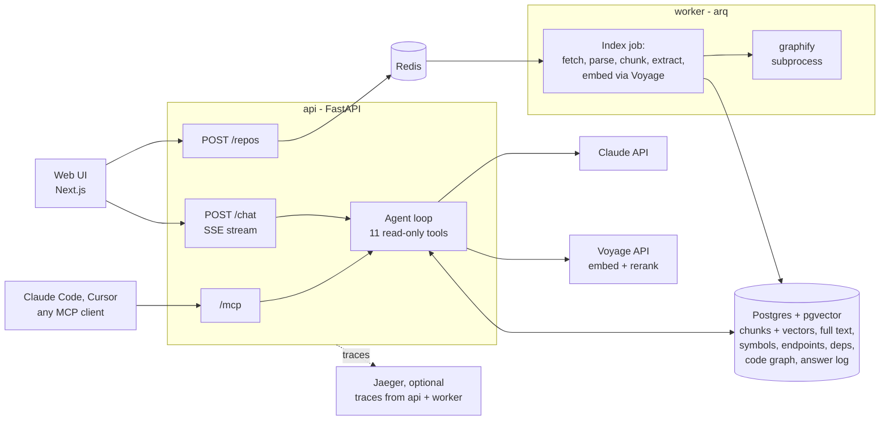

# Architecture

**Indexing** runs in the worker:
1. **Fetch:** shallow-clone at a recorded commit, unzip, or read a folder.
2. **Walk:** keep only text worth indexing: no binaries, lockfiles, vendored folders or files over 1 MB.
3. **Parse** each file with tree-sitter, then:
   - split it into syntax-aware chunks,
   - extract its symbols, imports, HTTP endpoints and manifest dependencies.
4. **Write** everything to Postgres in one transaction.
5. **Embed** the chunks, with a cache keyed by content hash. Meanwhile, graphify builds the code graph
   as a separate process.

PetClinic (103 files) takes 3.5 s, of which 2.3 s is the git clone.

**Answering** runs in the api:
1. The agent gets the question, a short description of the repository, and 11 tools.
2. It calls tools until it has the evidence, running several at once when it asks for them together.
3. It streams an answer with citations.

The UI shows each tool call live (the investigation trail). It turns each paragraph or list item with
a citation into a stop on a rail, which opens the cited lines. A footer gives the model, time and cost.
The same tools are exposed over MCP, so a coding agent can use the index directly
([mcp.md](mcp.md)).

| Area | Code |
|---|---|
| Indexing | [backend/app/ingest/](../backend/app/ingest/): source, chunker, symbols, endpoints, dependencies, code graph, pipeline |
| Retrieval | [backend/app/retrieval/](../backend/app/retrieval/): code-aware tokenizer, embeddings, reranker, hybrid search |
| Agent | [backend/app/agent/](../backend/app/agent/): tools, graph tools, prompt, loop, single-call RAG mode |
| Observability | [backend/app/observability/](../backend/app/observability/): logs, answer log, stats, tracing |
| Evaluation | [backend/evals/](../backend/evals/): 40 questions, graders, runner |
| UI | [frontend/components/](../frontend/components/): chat, answer view, trail, evidence panel, repo panel |

---

[README](../README.md#documentation) · Previous: [Quick setup](../README.md#quick-setup) · Next: [RAG and LLM approach](rag-and-llm.md)
