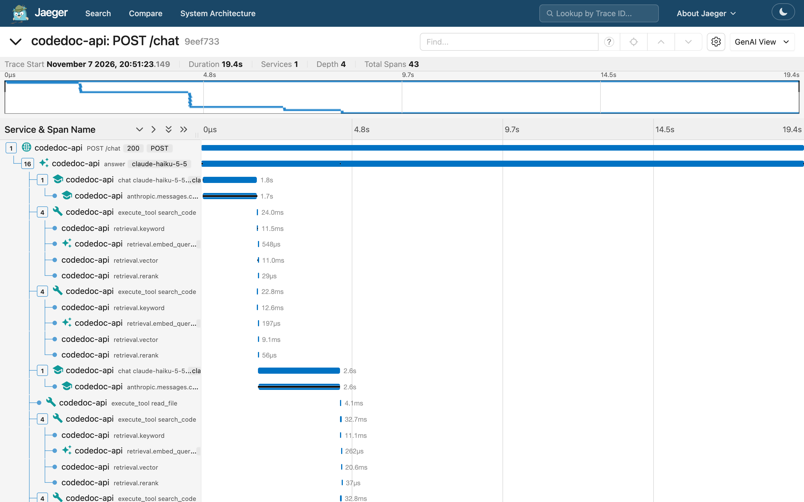

# Observability



Every answer, request and indexing job is recorded three ways.

**The answer log.** Each answer, from the web chat or MCP `ask_codebase`, is stored as a row in the
`answer_runs` table ([app/observability/answers.py](../backend/app/observability/answers.py)). The row records:
- source, repository, the models that served it, and status (`ok`, `error`, `refused`, `cut_off`, `cancelled`) with any error,
- total time and time to the first words,
- Claude calls and tokens by type, and cost (from [app/pricing.py](../backend/app/pricing.py), which the eval also uses),
- each tool call with its arguments, duration, result and error,
- the trace ID.

The question and answer text are stored too, unless `RECORD_ANSWER_TEXT=false`.

| Endpoint | Returns |
|---|---|
| `GET /stats?repo_id=&days=7` | answers by status; p50/p95 latency and time to first words; tokens and spend; spend by model; calls, error rate and p50/p95 time per tool; a daily series |
| `GET /answers?repo_id=&limit=50` | recent answers |
| `GET /answers/{id}` | one answer, with its full tool and Claude-call timeline |

The repository panel's **Usage** tab shows the same numbers for the last 7 days. The **Overview** tab
shows how long each indexing phase took.

**Structured logs.** The api, worker and MCP server write one JSON object per line to stderr
(`LOG_FORMAT=text` for readable lines when developing locally). Every line carries `request_id`,
plus `trace_id` when tracing is on. The api returns the request ID as an `X-Request-ID` header, and
reuses one sent by the caller.
- `http.request`: one per request, with method, path, status and duration. The duration covers
  the whole stream for chat.
- `answer.finished`: one per answer, with status, model, latency, tokens, tool calls and cost.
- `index.phase` / `index.finished`: per indexing phase, with seconds.
- `mcp.tool`: one per MCP code-tool call.

```bash
docker compose logs api | grep answer.finished
```

**Tracing** with OpenTelemetry (standard GenAI attribute names), off unless an OTLP endpoint is set.
The override file adds Jaeger and points the api and worker at it:

```bash
docker compose -f docker-compose.yml -f docker-compose.observability.yml up -d
```

Open <http://localhost:16686> and pick `codedoc-api` or `codedoc-worker`.
- **An answer** is a `POST /chat` trace: `answer` → one `chat <model>` span per Claude call (tokens
  including cache reads, finish reason, time to first output) and one `execute_tool <name>` span per
  tool call (with search stages under `search_code`). Under each Claude call, the Anthropic SDK adds
  its own `anthropic.messages.create` span with the API request ID.
- **An indexing job** is an `index_repo` trace with `index.fetch`, `parse`, `write`, `embed` and
  `graph` spans.
- **Privacy:** our spans never contain prompt or answer text, and no span records the API key.
  - The SDK's span records metadata only: model, tokens, request ID, and your Anthropic organization
    and workspace IDs.
  - The SDK also sends a `traceparent` header to the API.
  - `ANTHROPIC_OPEN_TELEMETRY=false` turns the SDK's tracing off. Leave
    `ANTHROPIC_OPEN_TELEMETRY_TRACES_CONTENT_MODE` unset, or the SDK records message content.

Any OTLP backend works in place of Jaeger: set `OTEL_EXPORTER_OTLP_ENDPOINT`.
